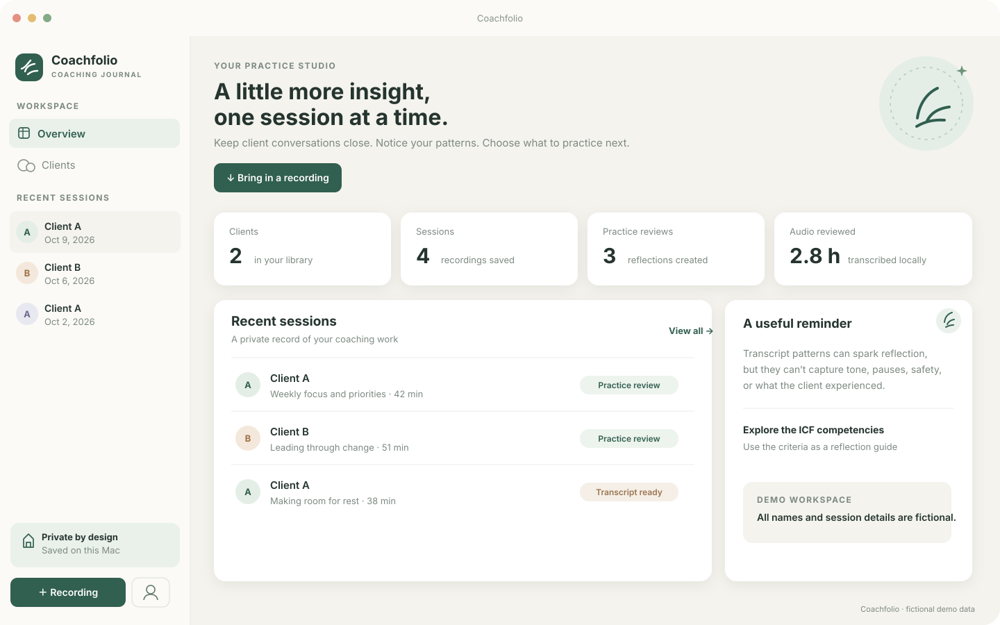
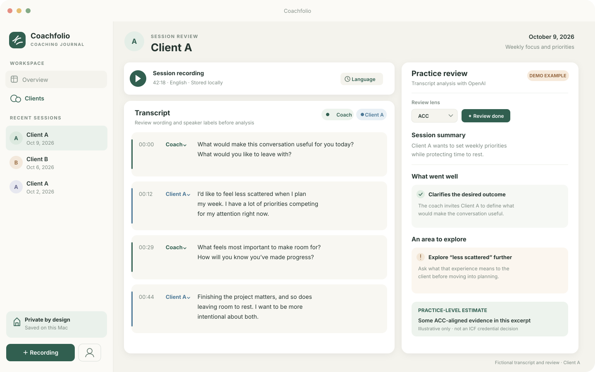

# Coachfolio

Coachfolio is a native macOS app for coaches to keep client and session records, transcribe coaching recordings, and reflect on their practice with transcript-linked feedback.

## Features

- Organize client profiles, notes, recordings, transcripts, and practice reviews.
- Transcribe audio on the Mac with WhisperKit and estimate two-speaker turns with SpeakerKit. The app stores speaker IDs so you can relabel all turns from one speaker together.
- Edit transcript wording and speaker labels before analysis. Press Return at the speaker change point to split a mixed-speaker turn. Press Delete at the beginning of a turn to join it to the previous turn; if their labels differ, choose the merged turn’s label. The speaker menu also offers **Merge with previous turn**. Click a turn’s timestamp or drag the recording seek bar to play from that point; playback follows the active turn in the transcript.
- Generate a structured practice review with strengths, growth areas, ICF competency evidence, an ACC/PCC practice-level estimate, and an ACC readiness estimate.
- Choose OpenAI GPT analysis or the available on-device/offline review mode in Settings.
- Jump from review evidence to the cited transcript turns.

Speaker labels and transcript wording are estimates. Review them against the recording before relying on the analysis.

## Screenshots

These are illustrative screen previews created for documentation using fictional demo content. Client names, dates, transcript excerpts, and practice-review notes are made up; no client records or recordings are shown.





## Privacy and session data

- Client records, session records, transcripts, and copied recordings are stored locally in `~/Library/Application Support/CoachJournal/`.
- Transcription and speaker separation run on the Mac. The first transcription downloads the local speech and speaker models; later sessions reuse the cached models.
- The app asks the coach to confirm client permission before playback, transcription, or analysis. GPT analysis also requires a separate confirmation for that session.
- When GPT analysis is requested, Coachfolio sends the transcript text, session date, and language to OpenAI. It does not send the recording, client profile, or session title. The API key is stored in macOS Keychain, and Responses API requests set `store` to `false`.
- A transcript may itself contain identifying details. Review OpenAI's current [API data controls](https://developers.openai.com/api/docs/guides/your-data) before enabling cloud analysis.
- The recordings in the local `audio/` folder are excluded from Git. Do not add client recordings, transcripts, or exports to a public repository.

Coachfolio is a practice aid. Its level and ACC readiness estimates are not ICF credential decisions or guarantees. Transcript text alone cannot establish tone, pauses, nonverbal behavior, client experience, or the wider coaching relationship. Use the linked criteria and review the recording and context yourself.

## Requirements

- macOS 26 or later
- Xcode 26 or later
- Internet access to resolve the Swift package and download local transcription models on first use
- An OpenAI API key only if you want GPT analysis. API usage is billed separately from ChatGPT subscriptions.

## Run from Xcode

1. Clone this repository and open `CoachJournal.xcodeproj`.
2. Select the **Coach Journal** scheme and run on a Mac running macOS 26 or later.
3. To use GPT analysis, open **Coachfolio > Settings**, add an OpenAI API key, and choose a model. On-device/offline review can be selected there instead.
4. Choose **Add recording**, select an audio file, and confirm the client permissions shown in the app.
5. Start transcription, check the transcript and speaker labels, then select the ACC or PCC practice lens and request a review.

To rebuild and reopen the latest source with one double-click, open `Restart Coachfolio.command` from Finder.

The app product is named **Coachfolio**. The Xcode project and scheme still use the original development name, **Coach Journal**. The existing bundle identifier and Application Support folder are retained so saved API keys and local session data remain available after the rename.

## Build from Terminal

```sh
xcodebuild -project CoachJournal.xcodeproj \
  -scheme "Coach Journal" \
  -configuration Debug \
  -derivedDataPath build \
  CODE_SIGNING_ALLOWED=NO build
```

The built app is written to `build/Build/Products/Debug/Coachfolio.app`.

## Project layout

```text
Assets.xcassets/              App icon assets
CoachJournal.xcodeproj/       Xcode project and pinned Swift package versions
Design/                       Source artwork for the app icon
Sources/                      SwiftUI interface, storage, transcription, and analysis
audio/                        Local-only recordings; ignored by Git
```

## ICF references

- [2025 ICF Core Competencies](https://coachingfederation.org/wp-content/uploads/2025/09/icf-cs-core-competencies-2025.pdf)
- [ACC credential performance evaluation criteria](https://coachingfederation.org/credentialing/performance-evaluations/criteria-for-assessing-acc/)
- [PCC credential performance evaluation criteria](https://coachingfederation.org/credentialing/performance-evaluations/criteria-for-assessing-pcc/)
- [ICF performance evaluations overview](https://coachingfederation.org/credentialing/performance-evaluations/)

## License

This project is licensed under the MIT License. See [LICENSE](LICENSE) for details.
